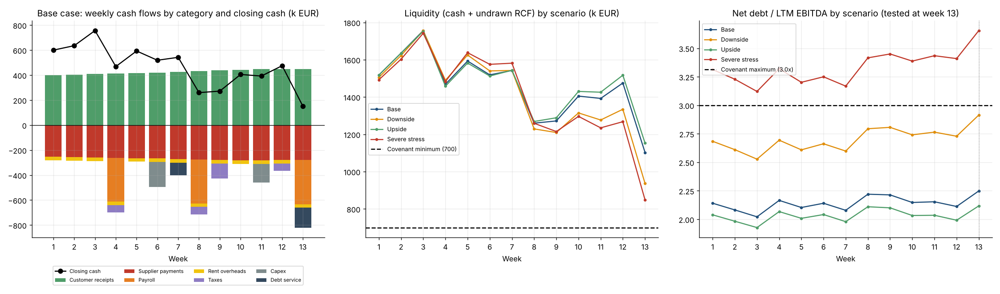

# 13-Week Cash Flow Forecast

Direct cash flow forecast over 13 weeks with a revolving credit facility (RCF), downside scenarios and automatic covenant tests. Built the way a treasury or FP&A team monitors short-term liquidity.



## What it does

- **Receipts**: weekly invoiced sales converted into cash through a collection curve (share of an invoice collected N weeks later), including invoices issued before week 1 and a bad-debt allowance
- **Disbursements**: suppliers (payment curve on purchases), payroll, rent and overheads, VAT / corporate tax, capex, term loan amortisation and interest, RCF interest
- **RCF logic**: the revolver is drawn automatically to keep a minimum operating cash balance and repaid when cash exceeds a threshold, within the facility limit
- **Scenarios**: Base, Upside, Downside and Severe stress, defined by sales level, customer payment delay, supplier terms, extra bad debt and EBITDA
- **Covenant tests**: minimum liquidity (cash + undrawn RCF) checked every week, maximum net debt / LTM EBITDA checked at quarter end, with headroom and breach weeks reported
- **Outputs**: summary table, three-panel chart, Excel workbook (one sheet per scenario)

## Sample result (fictional company, k EUR)

| | Base | Downside | Upside | Severe stress |
|---|---|---|---|---|
| Minimum liquidity | 1,103 | 937 | 1,153 | 848 |
| Peak RCF drawn | 82 | 213 | 82 | 302 |
| Net debt / EBITDA, week 13 | 2.2x | 2.9x | 2.1x | 3.7x |
| Covenants | OK | OK | OK | **Leverage breach** |

The liquidity covenant holds in every scenario, but under severe stress leverage exceeds the 3.0x limit at the week-13 test: the kind of early warning this tool is designed to give.

## Quick start

```bash
pip install -r requirements.txt
python -m cashflow13 --input data/sample_company.json --out outputs
pytest
```

To forecast another business, copy `data/sample_company.json` and change the figures. To add a scenario, add an entry to `SCENARIOS` in `cashflow13/model.py`.

## Project structure

```
cashflow13/model.py     Forecast engine, scenarios, RCF logic, covenant tests
cashflow13/report.py    Charts and Excel export
cashflow13/__main__.py  Command line entry point
data/sample_company.json  Fictional company inputs
tests/                  Unit tests (cash roll-forward identity, RCF limits, scenario ordering, covenant detection)
```

## Modelling notes

- Cash identity checked by tests: closing cash = opening cash + net cash flow before financing + RCF draws - RCF repayments.
- RCF and term loan interest are computed on the opening balance of each week, which avoids circular references.
- Leverage is shown every week for information but tested only at the dates listed in `leverage_test_weeks`.
- The Excel export contains values, not live formulas.

## Limits

- **The company is fictional** (Atlas Distribution SAS) and uses no data from any real employer or client.
- Weekly sales are an input, not forecast by the tool; no VAT mechanics on invoices beyond the tax payments entered.
- Simplified covenant definitions; real facility agreements define EBITDA and net debt precisely.

## Stack

Python · pandas · NumPy · Matplotlib · openpyxl · pytest
